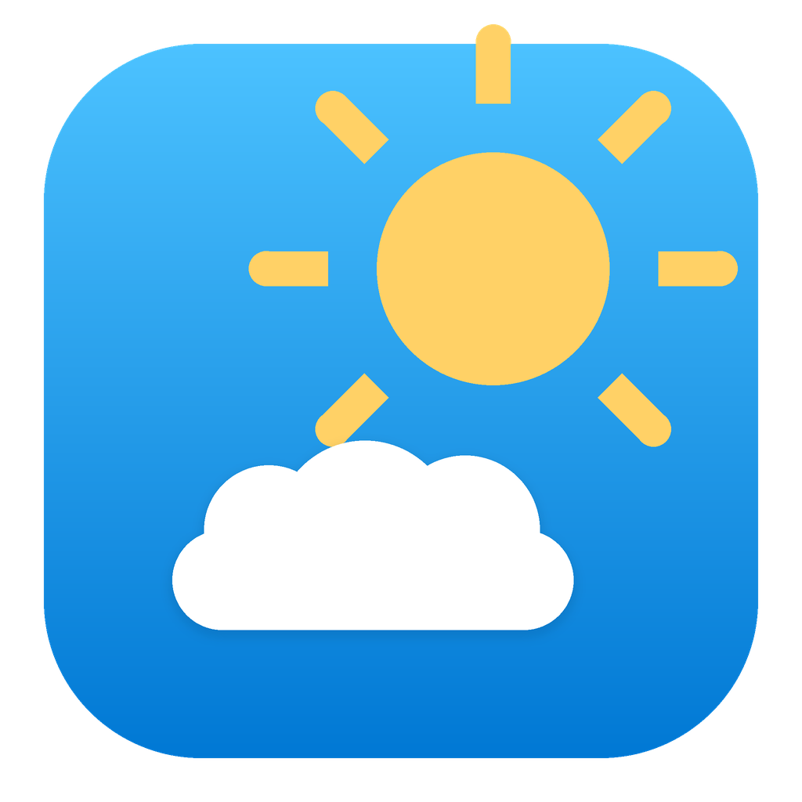
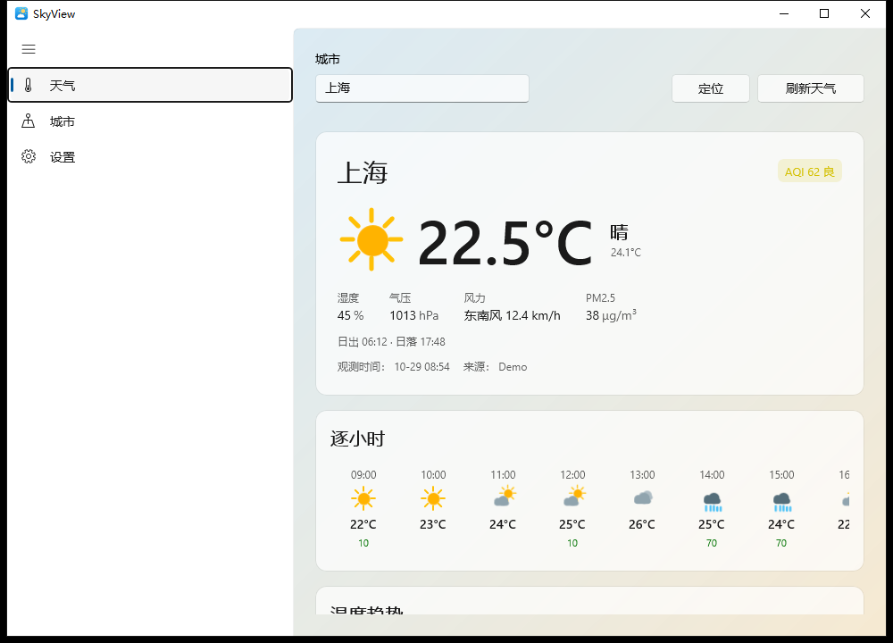
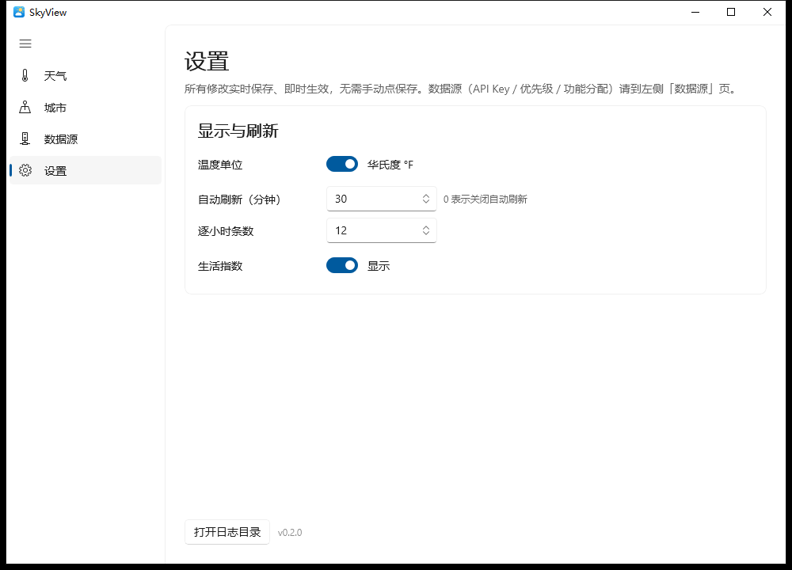
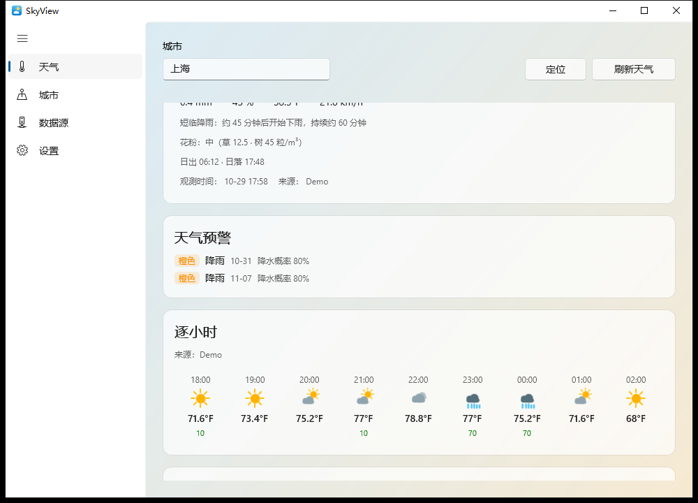
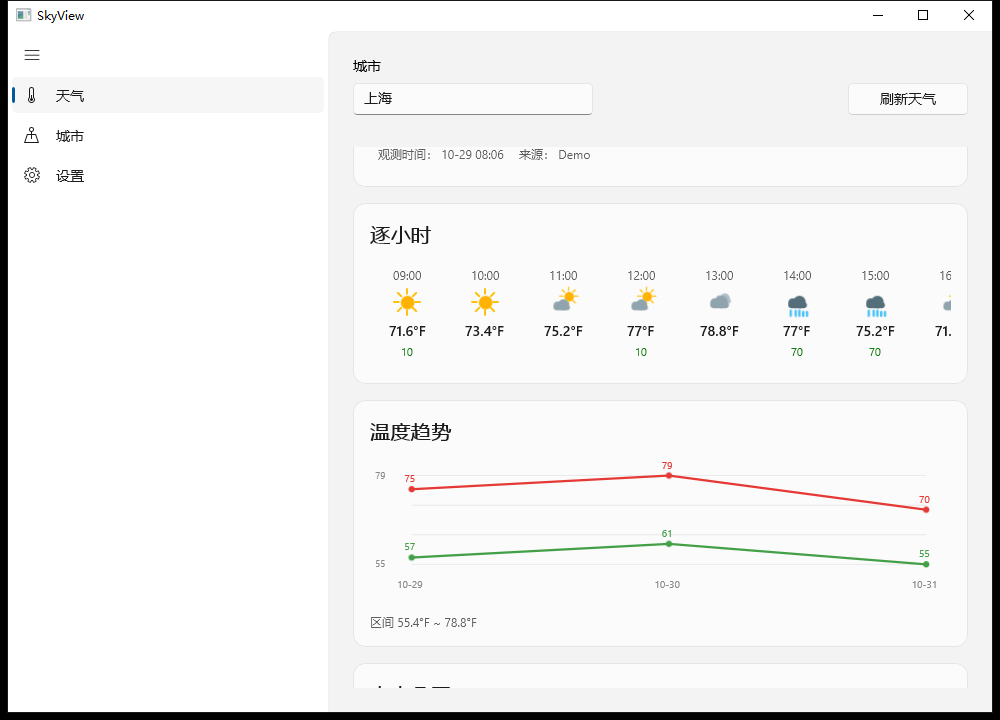
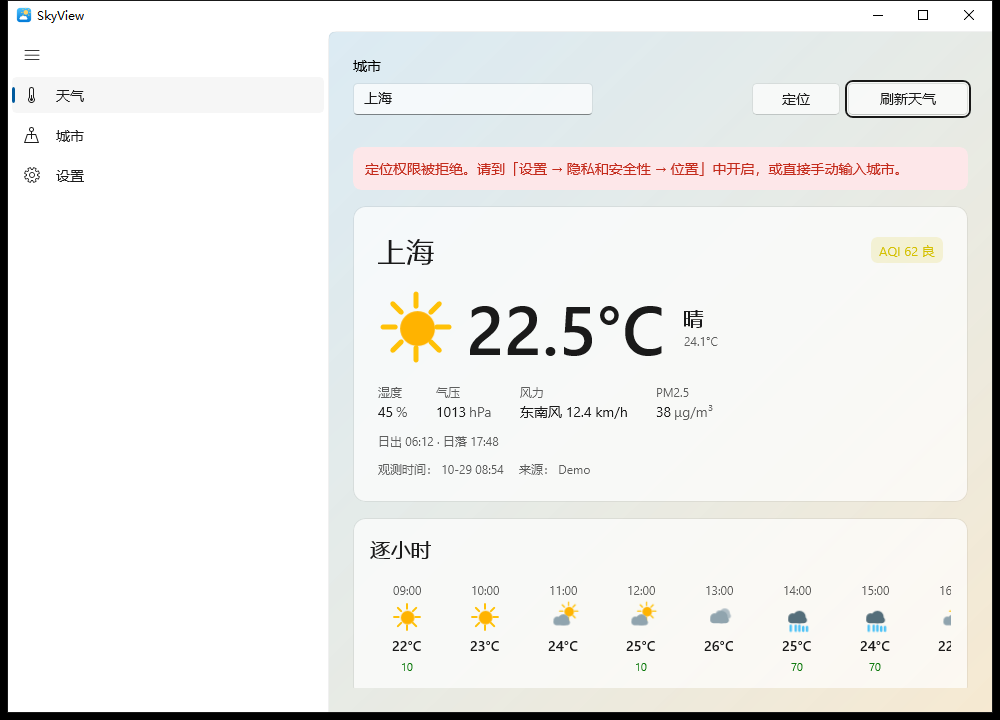

# SkyView

> Windows 11 原生（WinUI 3）的多数据源天气桌面应用。自包含发布，解压即跑，无需安装 .NET 运行时或 Windows App SDK。



SkyView 的目标是一个**不绑死单一天气服务商**的本地天气客户端：把多个数据源接到同一套数据模型上，按优先级自动降级；同时把"好看"和"好用"做扎实——矢量天气图标、天气主题背景、系统托盘常驻、定位当前城市、单实例运行。

---

## 功能特性

### 核心天气能力

- **多数据源 · 自动降级**：和风天气 / OpenWeatherMap / 心知天气 / AccuWeather / PirateWeather 接入同一套模型，按优先级依次尝试，前一个失败自动切下一个。设置页可一键「测试连接」验证每个源的可用性。
- **当前天气 · 逐小时 · 多日预报**：温度、体感、湿度、气压、风速风向、降水概率一应俱全。
- **温度趋势图**：当前页内嵌逐小时温度曲线，随单位切换同步换算。
- **温度单位切换**：°C / °F 一键切换，温度文本、逐小时、趋势区间全部同步换算。
- **自动刷新 + 激活刷新**：按设定间隔后台刷新；窗口从休眠/锁屏恢复时检测数据是否过期并补刷。
- **离线缓存**：最近一次成功结果落盘，断网或所有源都挂时仍能展示。

### 视觉与动效

- **矢量天气图标库（12 种）**：晴 / 多云 / 阴 / 小雨 / 雨 / 大雨 / 雷阵雨 / 雪 / 雾 / 沙尘 / 大风 / 未知。纯 XAML 图元拼装（非 Path 字符串），规避运行时解析崩溃；图层可组合显隐。
- **环境动效**：图标内太阳自旋、云朵漂移、雨雪飘落、闪电闪烁，幅度极小、循环播放，**尊重系统「减少动画」设置**。
- **入场错峰动画**：卡片依次淡入上移，整体观感更顺。
- **天气主题背景**：背景渐变随当前天气切换（晴蓝 / 阴灰 / 雨青 / 雪白 / 雷紫 …），带过渡动画。

### 桌面化体验

- **系统托盘常驻**：关闭窗口时最小化到托盘而非退出；托盘提示显示当前温度与城市；右键菜单可恢复窗口 / 刷新 / 退出。
- **定位当前城市**：优先 `Windows.Devices.Geolocation`，失败回退到 IP 定位，拿到经纬度后反查城市名并切换。
- **单实例运行**：用命名互斥量保证只起一个窗口；重复启动时激活已存在的窗口。
- **打开日志目录**：设置页一键打开 `%LOCALAPPDATA%\SkyView\` 日志目录，便于排障。
- **应用内版本号**：取自 git tag（如 `v1.0.0`），显示在设置页。

---

## 界面截图

| 主界面（天气主题背景） | 设置页 |
|:---:|:---:|
|  |  |

| 温度趋势图 | 预报与生活指数 | 托盘恢复后 |
|:---:|:---:|:---:|
|  |  |  |

（更多取证截图见 [`docs/shots/`](docs/shots/)。）

---

## 数据源

| 数据源 | 是否需要 API Key | 取数方式 | 备注 |
|--------|:---:|----------|------|
| 和风天气 QWeather | 是 | 城市名 / 经纬度 | 国内覆盖好，免费额度可用 |
| OpenWeatherMap | 是 | 城市名 / 经纬度 | 国际通用，免费档有调用频率限制 |
| 心知天气 Seniverse | 是 | 城市名 | 国内老牌服务商 |
| AccuWeather | 是 | **经纬度**（需先查 `locationKey`） | 美标高精度，免费档限频 |
| PirateWeather | 是 | **经纬度** | Dark Sky 的精神继任者，注册即用 |

> AccuWeather 与 PirateWeather 都要求经纬度入参。SkyView 内置一个基于 [Open-Meteo](https://open-meteo.com/) 的**免密钥地理编码服务**，把城市名解析成经纬度，无需为定位单独申请 Key。

默认仅启用第一个配置的源，其余在 `appsettings.json` / 设置页中按需开启。Key 通过 [`ISecureConfigStore`](src/SkyView.Core/Providers) 存储，不落明文。

---

## 快速开始

### 直接运行（推荐）

到 [Releases](../../releases) 下载 `SkyView-vX.Y.Z-win-x64.zip`，解压后双击 `SkyView.exe` 即可。自包含发布已内置 .NET 与 Windows App SDK 运行时，**目标机无需任何预装**。

### 从源码构建

```powershell
# 需要 .NET 10 SDK + Windows 10 SDK（见 BUILD.md「环境要求」）
git clone <本仓库地址>
cd SkyView

# 本地运行（开发模式，需要本机有 .NET 运行时）
dotnet run --project src/SkyView -c Release

# 自包含发布（目标机免运行时）
dotnet publish src/SkyView/SkyView.csproj -c Release
# 产物在 src/SkyView/bin/x64/Release/net10.0-windows10.0.19041.0/win-x64/publish/
```

设置 API Key：编辑 `src/SkyView/appsettings.json` 的 `Providers` 数组，或在设置页填入（经安全存储）。

> 想快速看界面效果而不配置任何 Key？设置环境变量 `SKYVIEW_DEMO=1` 启动，应用会加载内置演示数据（覆盖所有天气类型），方便预览图标与布局。

---

## 版本与发布

- **版本号取自 git tag**：`v1.2.0` → 程序集版本 `1.2.0`。构建时由 `SkyView.csproj` 里的 `ResolveVersionFromGitTag` 目标执行 `git describe --tags` 注入；无 git 时回退到 `0.0.0`。应用内设置页展示该版本号。
- **CI / 发布流程**：见 `.github/workflows/`：
  - `ci.yml`：push / PR 时编译并跑单元 + 组件测试（不含需要真实桌面的 UI 测试）。
  - `release.yml`：推送 `v*` 标签即自动发布——取 tag 注入版本、跑测试、自包含发布、校验关键产物（`SkyView.pri` / `coreclr.dll` 等）、打包 zip、创建 GitHub Release。
  - 手动触发 `release.yml` 会生成一个 **draft** 预发布，避免误发正式版本。

> 发布脚本刻意**不使用** `dotnet publish -o <自定义目录>`：自定义输出目录会导致 `SkyView.pri`（XAML 的 XBF 资源）丢失，产物在目标机启动即崩（0xC000027B）。正确做法是发布到默认位置再复制打包。

---

## 测试

| 层 | 框架 | 内容 | 运行 |
|----|------|------|------|
| 单元测试 | xUnit + Moq | 数据源 JSON 解析、单位换算、图标选择、主题映射 | `dotnet test tests/SkyView.UnitTests` |
| 组件测试 | xUnit + Moq | ViewModel / 服务级行为 | `dotnet test tests/SkyView.ComponentTests` |
| UI 冒烟 | xUnit | 进程启动 / 窗口可见 / 无崩溃 | `dotnet test tests/SkyView.UITests` |
| 一键验证 | `tools/run_all.py` | 构建 → 发布 → 三层测试 → 产物完整性 → UI 检查（uiautomation + pywinauto） | `python tools/run_all.py` |

> UI 自动化测试与 `run_all.py` 中的交互检查需要**真实桌面会话**（WinAppSDK 的 UI 合成依赖 Composition 桌面），无法在 CI 托管 runner 上运行，因此交给本地脚本。CI 只跑不依赖图形的两层测试。

---

## 目录结构

```
SkyView.sln
├── src/SkyView.Core/      # 非 UI 类库 (net10.0)：模型 / 数据源 / 服务 / ViewModel / 存储 / 主题
├── src/SkyView/           # WinUI 3 应用 (net10.0-windows10.0.19041.0)
│   ├── Assets/SkyView.*   # 应用 Logo（ico/png/banner，由 tools/make_icon.py 生成）
│   ├── Controls/          # 矢量天气图标 WeatherIcon
│   ├── Motion/            # 入场 / 弹入动画（尊重系统减少动画）
│   ├── Theming/           # 天气主题背景配色
│   ├── Shell/             # 系统托盘、单实例、定位
│   └── Views/             # 主页 / 设置页
├── tests/                 # 单元 / 组件 / UI 测试
├── tools/                 # 一键验证、UI 检查、截图取证、图标生成
└── docs/shots/            # 界面取证截图
```

更详细的构建配置、曾踩过的真实坑（含「界面启动不了」的多个根因）见 [**BUILD.md**](BUILD.md)。
